# Как работать в панели

Инструкция для менеджеров GetVisa (визы) и Frunze Travel (туры). Идём по ней
вместе с Аланом, по порядку, как проходит рабочий день.

Все имена и номера на картинках выдуманы. Красные рамки и цифры на картинках
нарисованы для этой инструкции, в самой панели их нет.

---

## За 5 минут: самое главное

1. **Главное окно — «Главная».** На ней сверху клиент, который дольше всех ждёт
   ответа, а справа ваши дела на сегодня. Начинайте день отсюда.
2. **Красное «ждёт 5 ч» — человек ждёт вас.** Чем краснее метка, тем дольше
   клиент без ответа. Сначала отвечайте тем, у кого метка красная.
3. **Написали клиенту из панели — бот замолчал.** С этим клиентом дальше говорите
   вы. Чтобы бот снова отвечал, нажмите «Вернуть боту».
4. **Каждое утро открывайте «Мои дела».** Там напоминания: кому позвонить и
   кому написать повторно (касания). Сделали — нажмите «Сделано».
5. **Клиент отказался — закройте его с причиной.** Меню «⋮» в переписке →
   «Клиент отказался» → одна из восьми причин. Без причины не закрывайте.

Что-то не так — пишите Алану (подробнее в разделе 11).

---

## 1. Вход

**Что сделать.** Откройте в браузере адрес панели и войдите под своим логином.

- Адрес: **https://crm.frunzetravel.kg/admin/login** (запасной:
  https://frunzetravel.kg/admin/login). Сохраните его в закладки.
- Логин и пароль выдаёт Алан. У каждого свой: `medina`, `daulet`, `marsel`.
  Чужим логином не входите, иначе панель покажет чужих клиентов, а ответы
  будут записаны на другого человека.

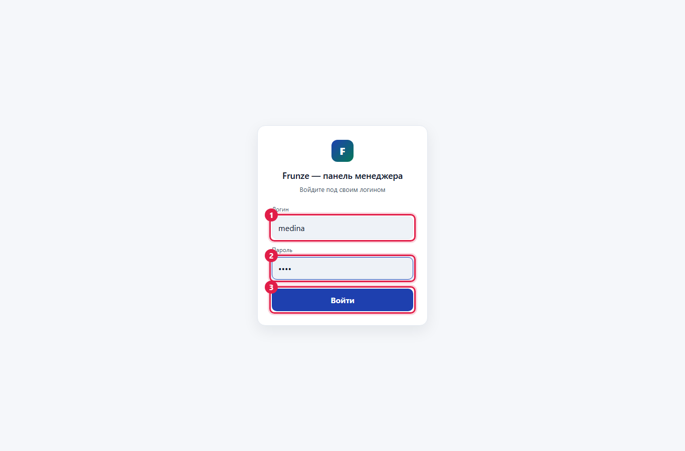

1 — логин, 2 — пароль, 3 — кнопка «Войти».

**Что должно получиться.** Откроется «Главная» (раздел 2).

**Если не пускает:**

- «Неверный логин или пароль». Проверьте раскладку (логин пишется
  латиницей) и не нажат ли Caps Lock.

  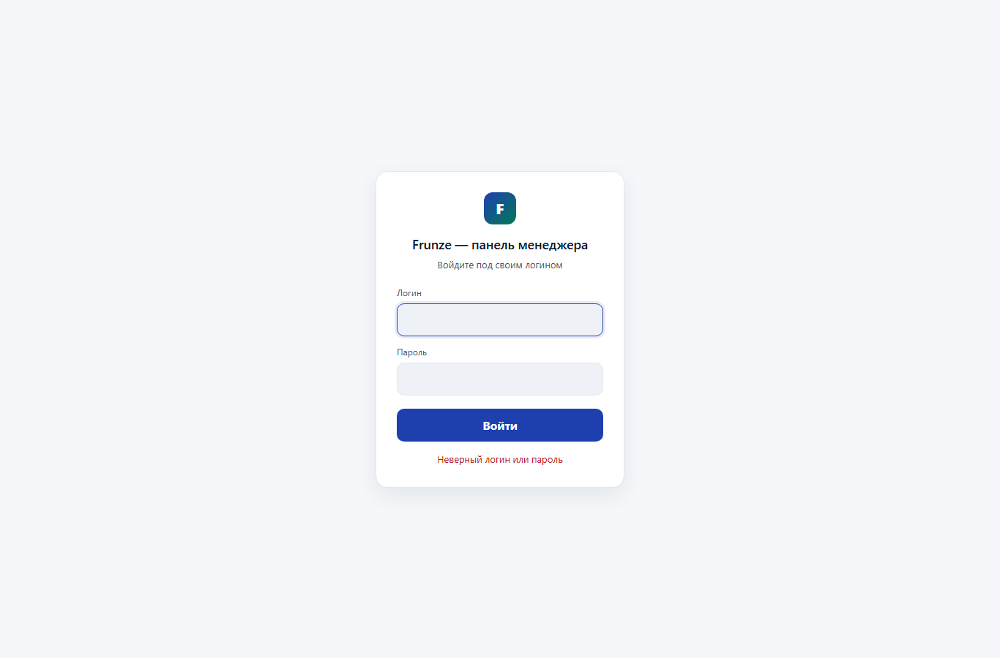

- «Слишком много попыток. Подождите минуту». Подождите минуту и
  попробуйте снова, аккуратно.
- Не пускает и после этого — напишите Алану. Пароль сами не подбирайте.

---

## 2. Главная: кому ответить сейчас

После входа вы сразу попадаете на «Главную». Вверху меню: **Главная · Диалоги ·
Мои дела · Договоры · Ещё**.

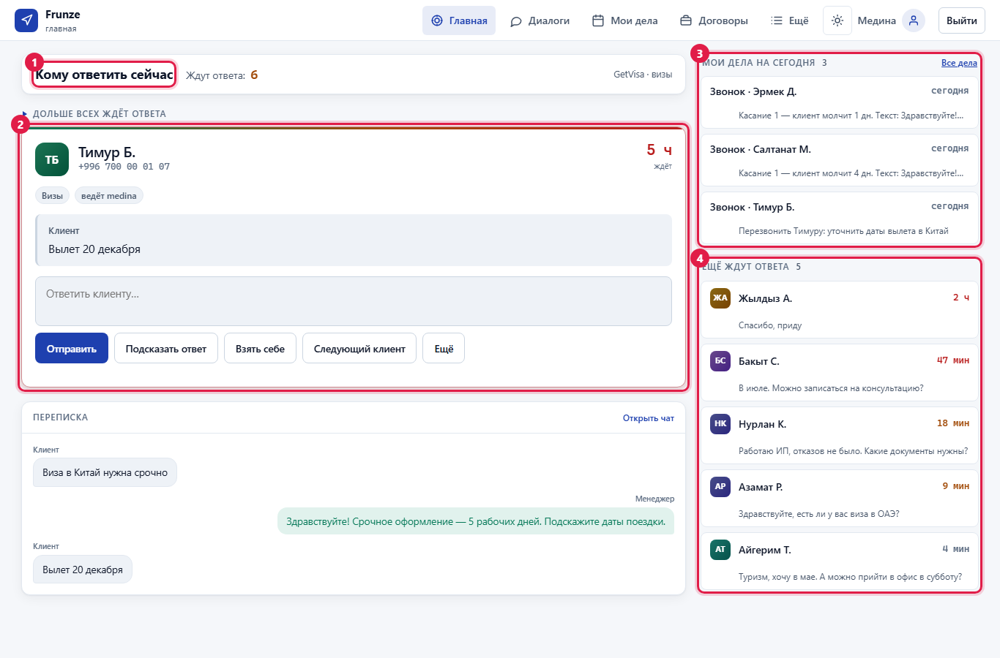

1. **«Кому ответить сейчас»** и число: сколько клиентов ждут ответа.
2. **Клиент, который ждёт дольше всех.** Справа время ожидания («5 ч ждёт»).
   Ниже последнее сообщение клиента и поле «Ответить клиенту…». Кнопки:
   - **Отправить** — ответ уйдёт клиенту в WhatsApp;
   - **Подсказать ответ** — бот предложит черновик, вы его проверяете и
     отправляете сами;
   - **Взять себе** — клиент закрепится за вами, бот с ним замолчит;
   - **Следующий клиент** — отложить этого и показать следующего;
   - ниже «Переписка» и ссылка **«Открыть чат»**, если нужна вся история.
3. **«Мои дела на сегодня»** — звонки и касания на сегодня
   (подробно в разделе 7). «Все дела» открывает полный список.
4. **«Ещё ждут ответа»** — очередь за первым клиентом. Нажмите на имя, чтобы
   ответить ему.

**Что должно получиться.** Вы ответили первому клиенту, и наверху появился
следующий. Делайте так, пока очередь не опустеет.

---

## 3. Диалоги: кто ждёт ответа

**Что нажать.** В верхнем меню **«Диалоги»**. Откроется вкладка **«Входящие»**.

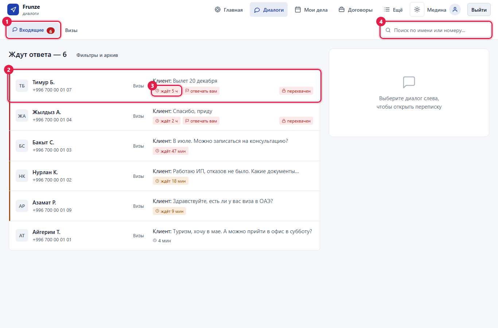

1. **«Входящие»** — все, кто ждёт ответа; в красном кружке их число.
2. Строка с клиентом: имя, номер, последнее сообщение.
3. **«ждёт 5 ч»** — столько клиент ждёт ответа. Метка жёлтая, пока ждёт
   недолго, и становится красной, когда ждёт долго. Красная полоска слева у
   строки означает то же самое.
   - «отвечать вам» — клиент закреплён за вами;
   - «перехвачен» — с клиентом говорит человек, бот молчит.
4. **Поиск** — по имени или номеру (раздел 11).

Ответили клиенту — он уходит из списка. Список обновляется сам примерно раз в
10 секунд.

---

## 4. Переписка: прочитать, ответить, отправить файл

### 4.1. Открыть переписку

**Что нажать.** Нажмите на строку клиента в «Входящих». Справа откроется чат.

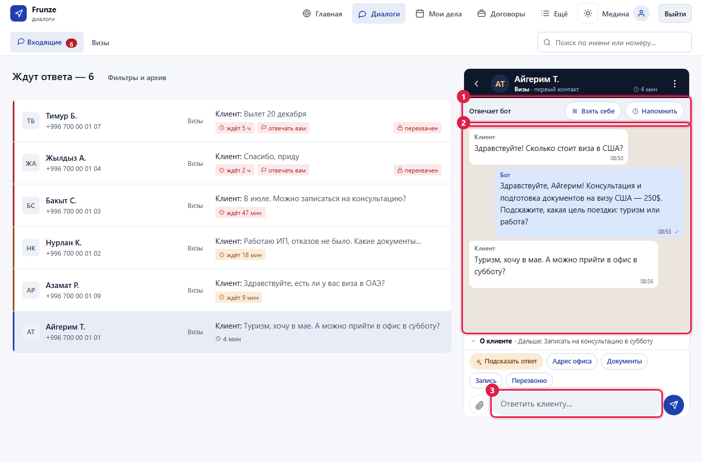

1. **Кто отвечает клиенту.** «Отвечает бот» — сейчас клиенту пишет бот.
   Рядом кнопки **«Взять себе»** и **«Напомнить»**.
2. Переписка. Слева сообщения клиента, справа ответы бота (голубые) и
   менеджера (зелёные).
3. Поле **«Ответить клиенту…»**.

Под перепиской есть строка **«О клиенте»**: в ней коротко, что бот понял о
клиенте и что делать дальше. Ещё ниже быстрые ответы («Адрес офиса»,
«Документы», «Запись», «Перезвоню»): нажатие вставляет готовый текст в поле.

### 4.2. Ответить клиенту

**Что нажать.** Напишите текст в поле и нажмите синюю круглую кнопку со
стрелкой (2).

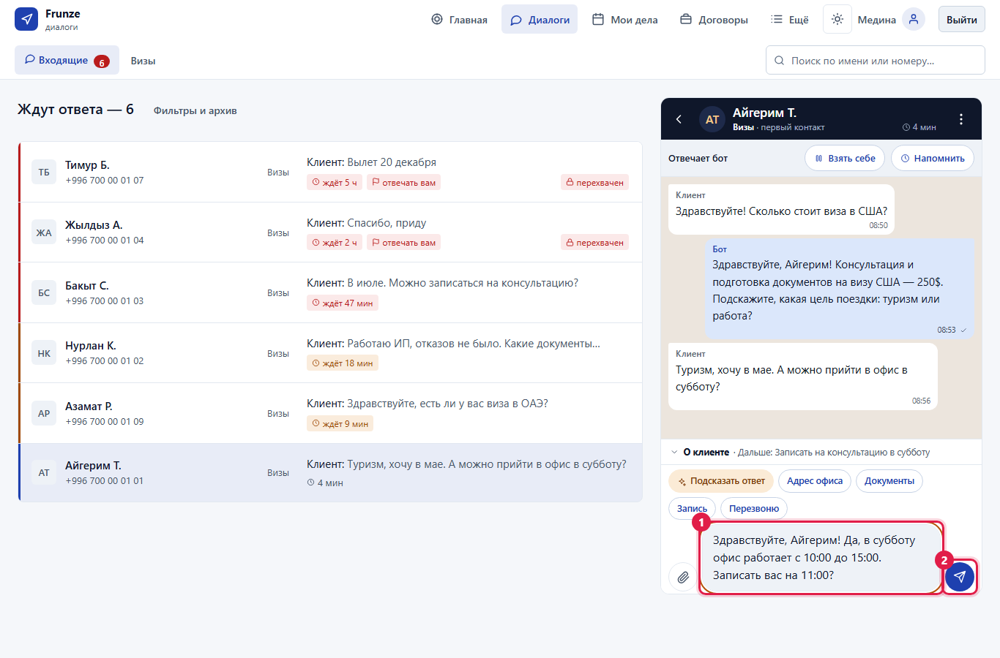

**Что должно получиться.** Ваше сообщение появилось в переписке зелёным, под
ним галочка, значит отправлено. Наверху теперь написано **«Отвечаете вы — бот
молчит»**.

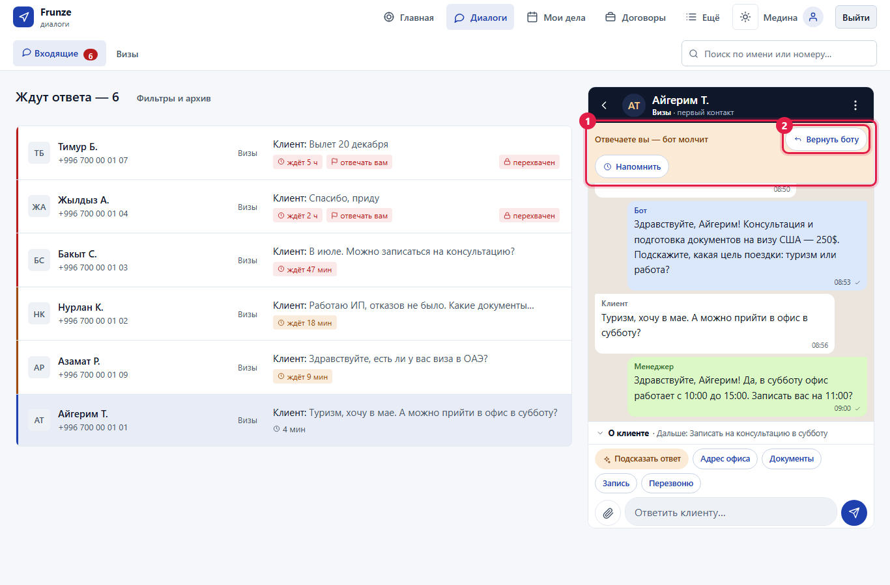

1. **«Отвечаете вы — бот молчит».** После вашего ответа бот этому клиенту
   больше не пишет: говорите с ним вы.
2. **«Вернуть боту»** — нажмите, если хотите, чтобы бот снова отвечал этому
   клиенту (например, ночью). Пока не нажмёте, бот молчит.

> Бот молчит именно с этим клиентом. Остальным он отвечает как обычно.

Под сообщением может появиться надпись **«неизвестно, дошло ли — проверьте»**
или **«не отправлено»**. Значит, WhatsApp не подтвердил отправку. Проверьте
переписку в телефоне и только потом отправляйте повторно, иначе клиент может
получить сообщение дважды.

### 4.3. Отправить фото или файл

**Что нажать.** Скрепка слева от поля ответа (1), выберите файл, при желании
добавьте подпись и нажмите **«Отправить файл»** (2). Передумали — «Отмена».

Можно отправить PDF, фото (JPG, PNG, WEBP), Word (DOCX) и Excel (XLSX), не больше
10 МБ.

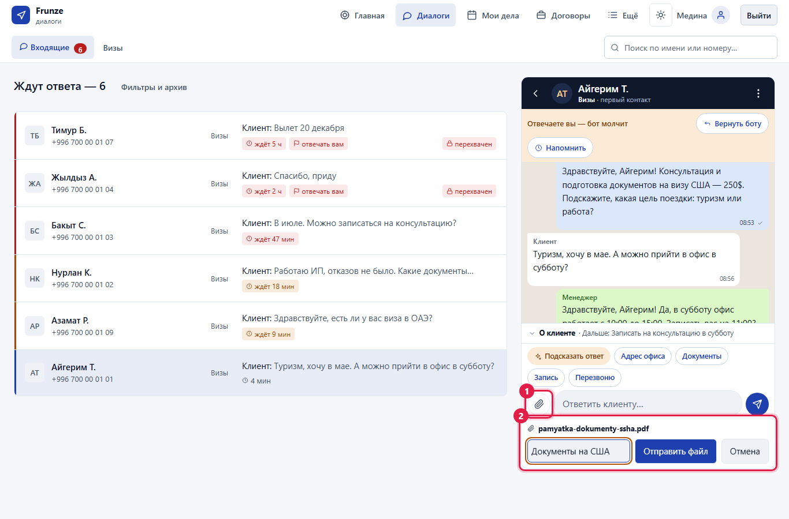

**Что должно получиться.** Файл появился в переписке со скрепкой и галочкой.

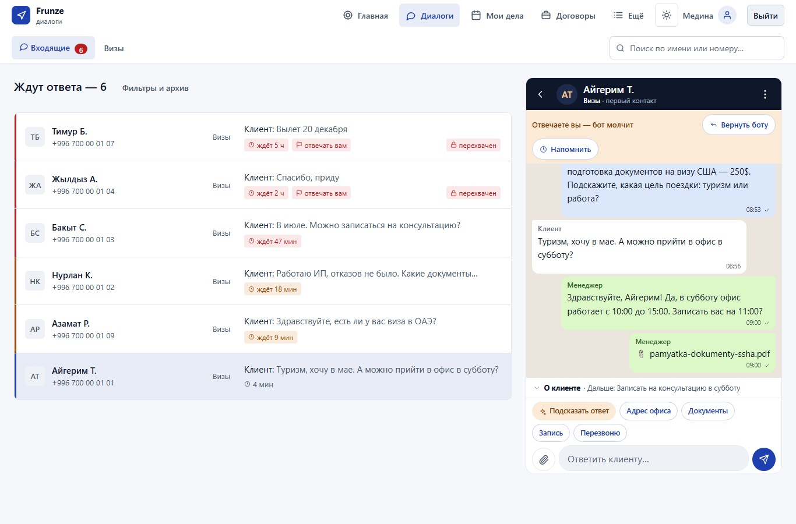

### 4.4. Поставить себе напоминание

Клиент сказал «перезвоните завтра»? Нажмите **«Напомнить»** (1), выберите, что
сделать и когда, напишите, о чём, и нажмите **«Поставить»** (2). Галочка
«Важно» поднимет дело выше в списке. Напоминание появится в «Мои дела» в
выбранный день.

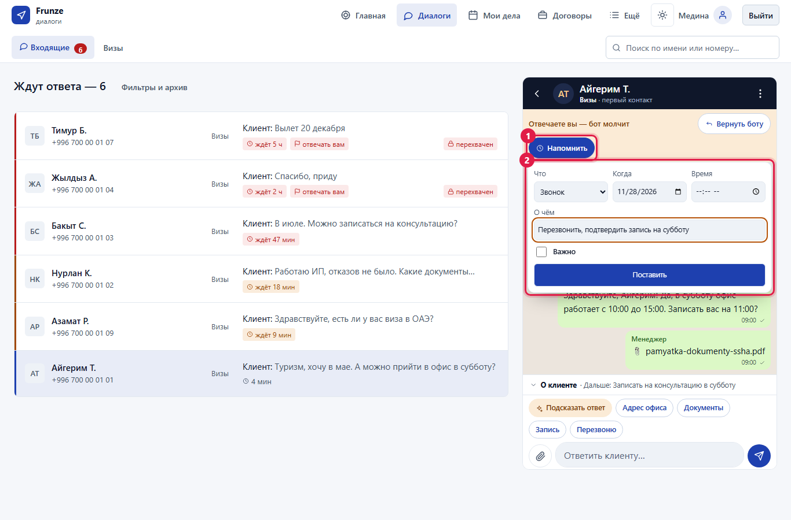

---

## 5. Карточка клиента: данные по визе

Под перепиской есть строка **«Данные по визе»**. Пока поля пустые, рядом написано
«не заполнено — нажмите, чтобы заполнить».

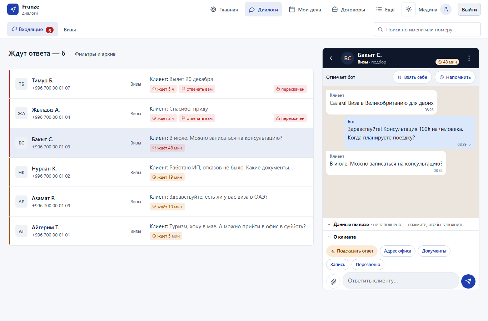

**Что сделать.** Нажмите на «Данные по визе» — откроются пять полей:

- **Гражданство** — выберите из списка;
- **Страна назначения** — куда едет клиент, например «Германия»;
- **Тип визы** — туристическая, гостевая, рабочая и т. д.;
- **Даты поездки** — как сказал клиент, своими словами;
- **Стоимость услуги** — сумма и валюта.

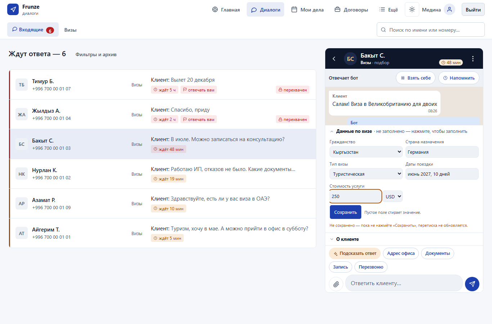

Нажмите **«Сохранить»**. Пустое поле стирает значение — если ошиблись, просто
очистите поле и сохраните.

**Что должно получиться.** В строке появится то, что вы заполнили, например
«Германия · Туристическая». По этим полям потом считается отчёт «клиенты по странам»,
поэтому заполняйте их у каждого визового клиента.

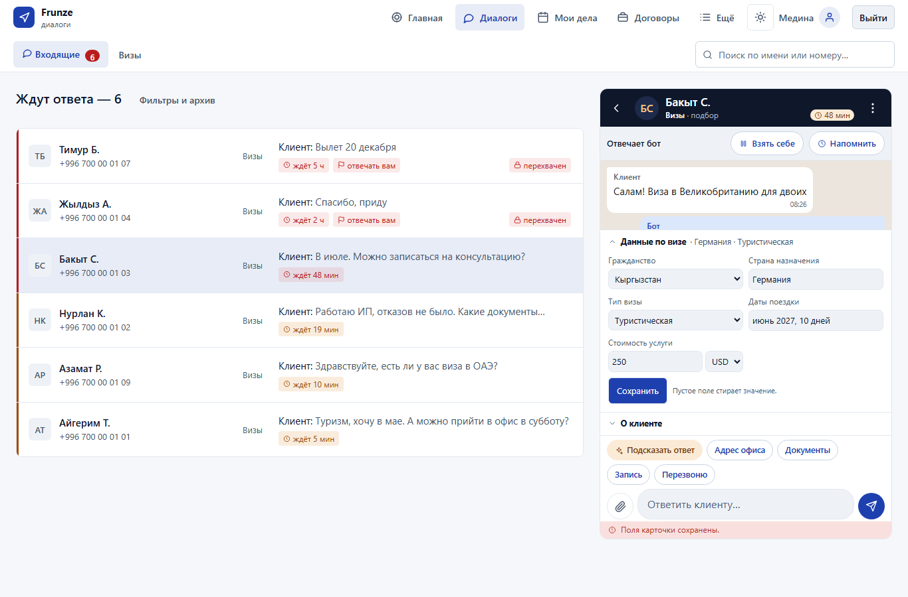

Пока вы заполняете поля и не нажали «Сохранить», внизу горит оранжевая строка
**«Не сохранено — пока не нажмёте «Сохранить», переписка не обновляется»**. Это
нормально: так набранное не пропадает. Нажмите «Сохранить» — новые сообщения клиента
снова начнут появляться сами. С телефона — так же:

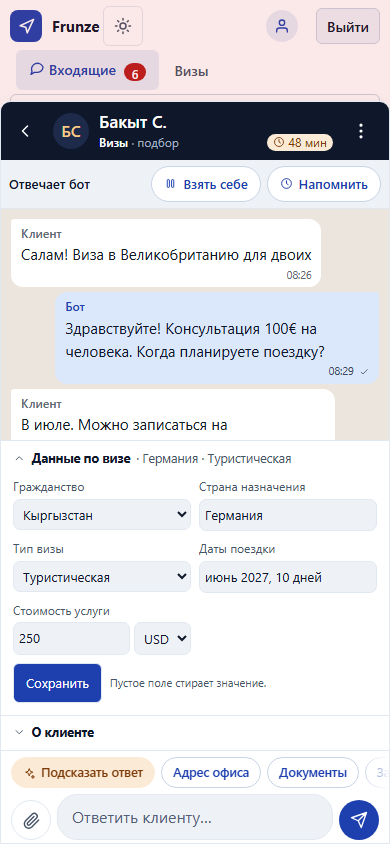

Сохранение полей **не** забирает клиента себе и не выключает бота.

---

## 6. Доска: где сейчас каждый клиент

Доска показывает всех клиентов по этапам, слева направо.

**Что нажать.** «Диалоги» → вкладка **«Визы»** (у туров **«Туры»**).

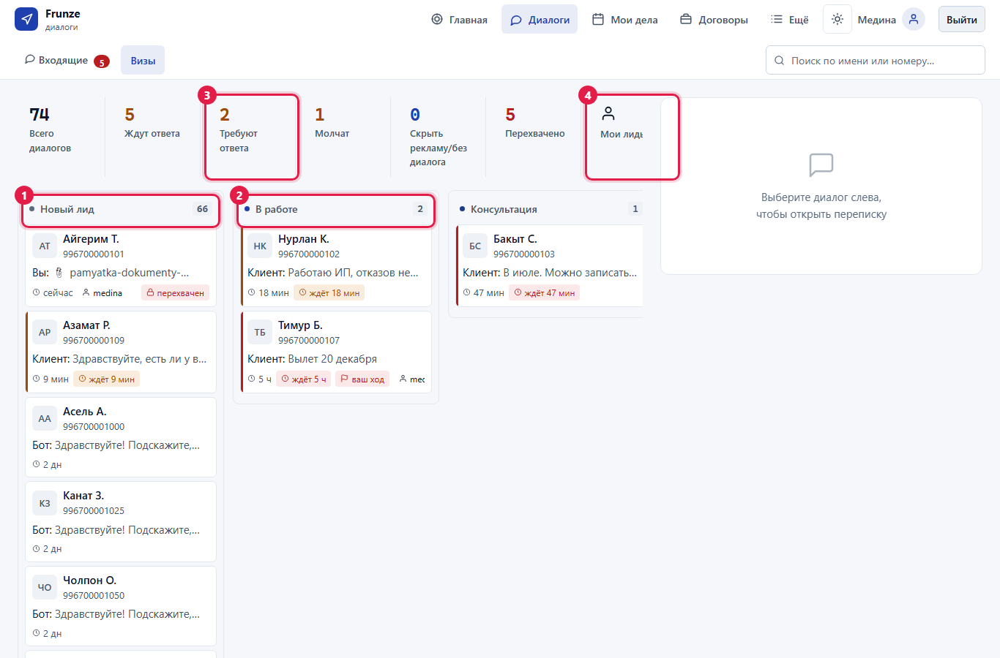

Колонки визовой доски:

| Колонка | Что значит |
|---|---|
| **Новый лид** (1) | клиент только написал |
| **В работе** (2) | вы связались и уточняете детали |
| **Консультация** | идёт консультация |
| **Ожидаем ответ** | клиент замолчал |
| **Касания** | клиенту пишем повторно (раздел 7) |
| **Записан в офис** | клиент записан на визит |
| **У менеджера** | бот передал клиента человеку |

На ноутбуке видно три–четыре колонки. **Остальные открываются прокруткой
вбок**: тачпадом двумя пальцами или колёсиком мыши с зажатым Shift.

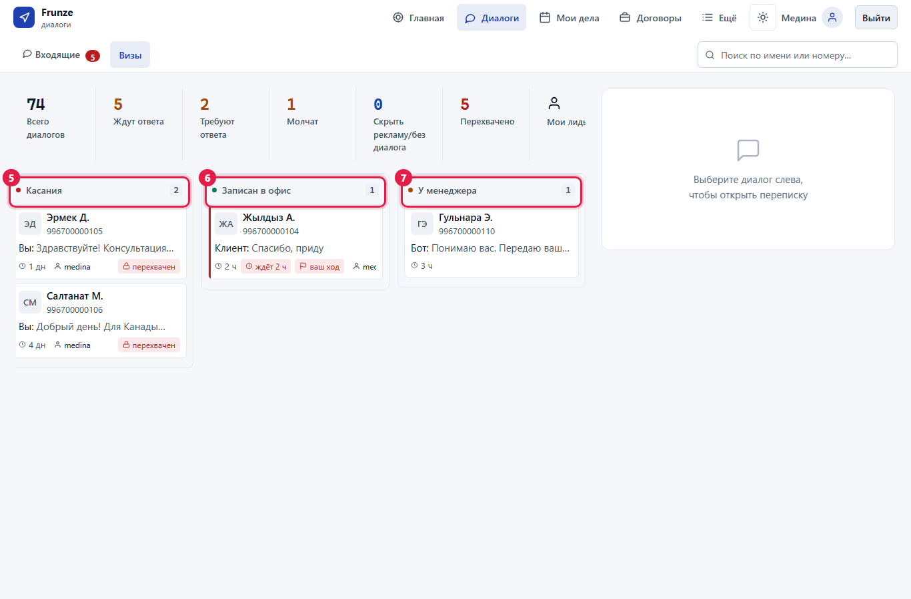

Над колонками счётчики:

- 3 — **«Требуют ответа»**. Нажмите, и на доске останутся только те, кто ждёт
  вашего ответа. Нажмите ещё раз — снова видны все.
- 4 — **«Мои лиды»**. Нажмите, и останутся только ваши клиенты. Кнопка
  превратится в «Все лиды», ею можно вернуть всех.

### 6.1. Перенести клиента в другую колонку

**Что сделать.** Зажмите карточку мышью и перетащите в нужную колонку.

**Что должно получиться.** Карточка осталась в новой колонке (на картинке
Азамат переехал из «Новый лид» в «В работе»).

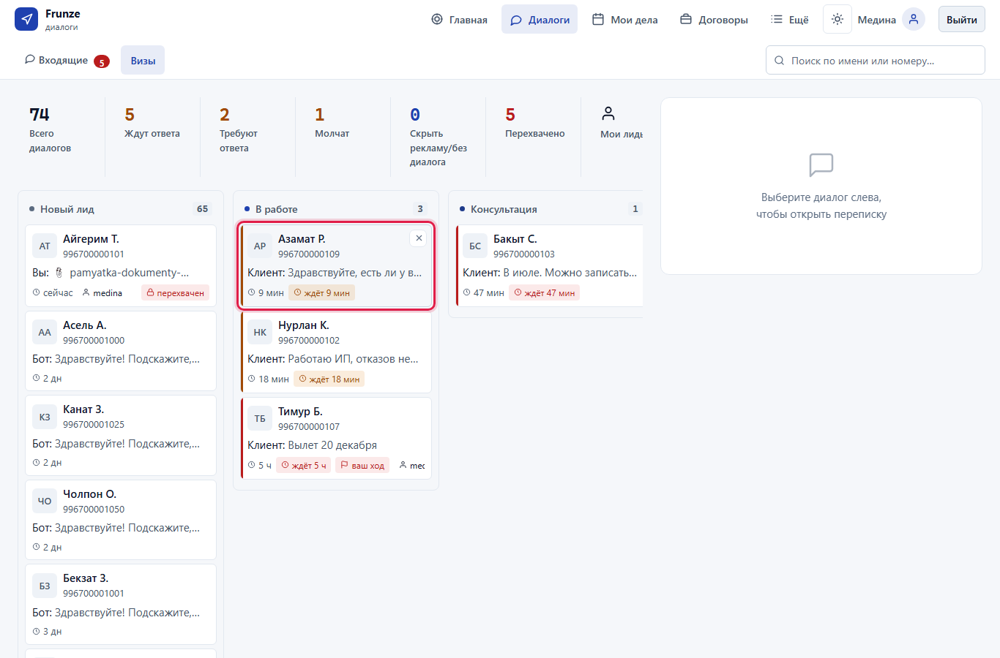

Сама по себе карточка из «Новый лид» в «В работе» не переезжает: переносите её
руками, когда начали работать с клиентом.

### 6.2. «Требуют ответа» и «Мои лиды»

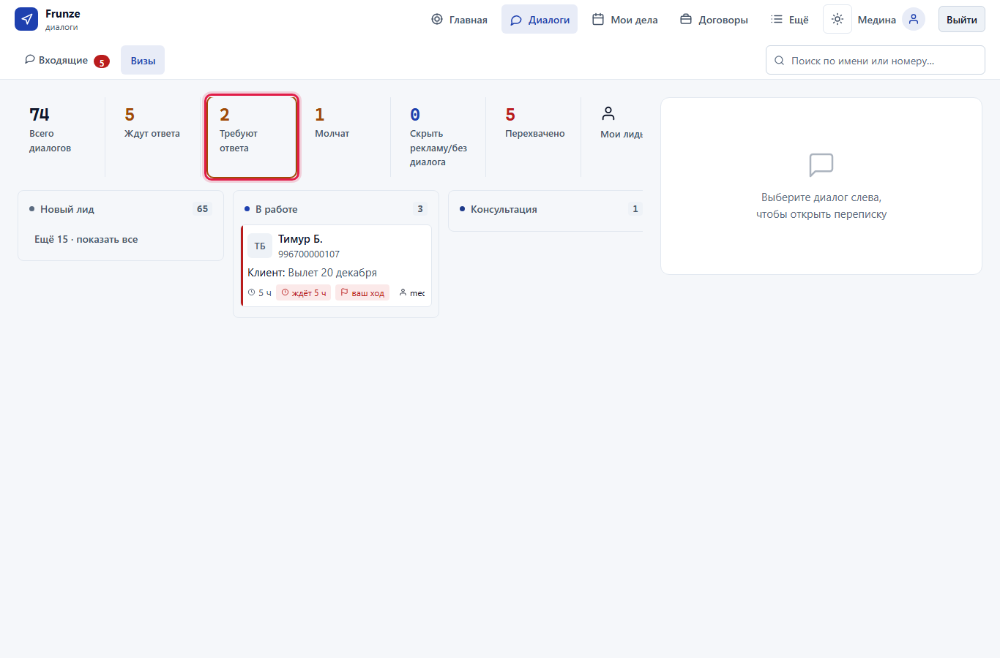

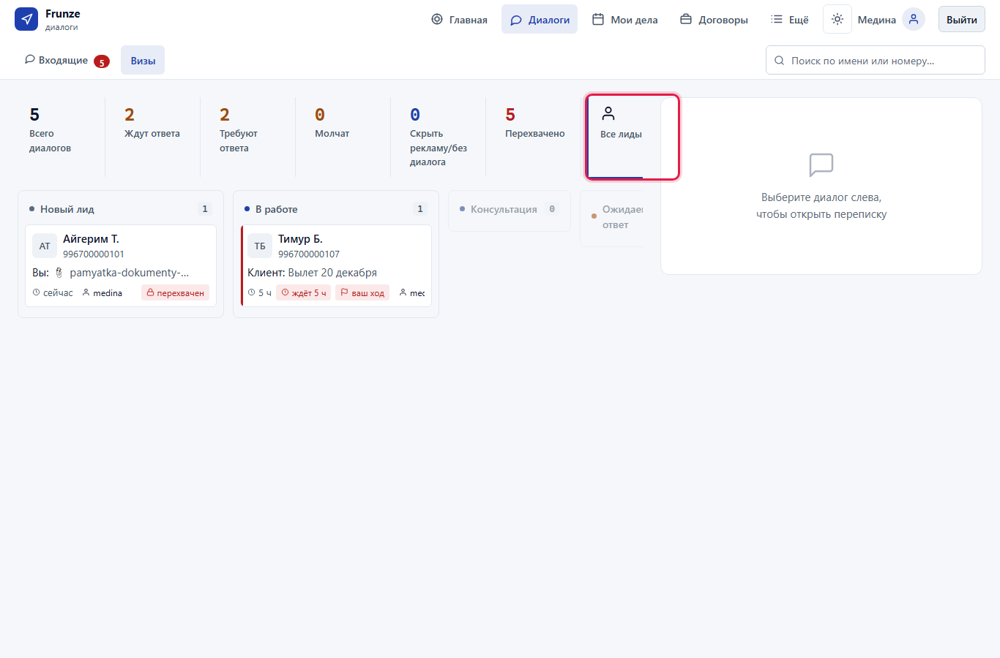

### 6.3. «Ещё N · показать все»

В колонке видно 50 карточек, сначала самые свежие. Если клиентов больше, внизу
колонки появится кнопка **«Ещё 16 · показать все»**. Нажмите, чтобы увидеть всех.
Вернуть короткий вид можно кнопкой «Свернуть колонки» в ряду счётчиков.

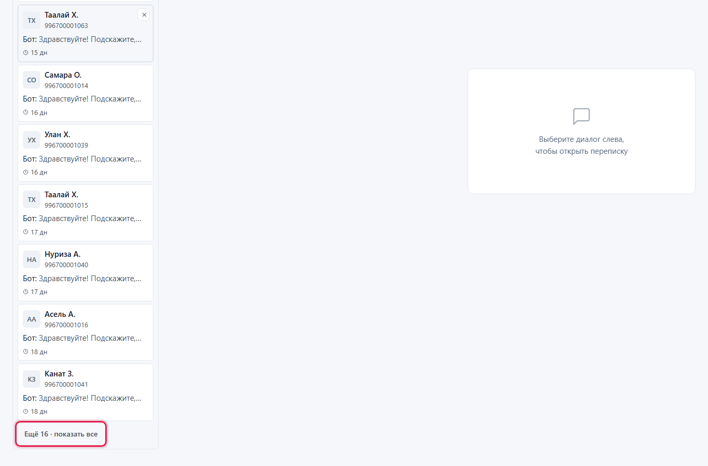

Нажатие на любую карточку открывает переписку справа, как во «Входящих».

---

## 7. Касания: напоминания написать клиенту повторно

Если клиент замолчал после вашего ответа, панель сама ставит вам дело
написать ему снова: **через 1 день, через 3 дня и через 6 дней**. Пишет клиенту
не бот, а вы: текст подсказки уже готов.

**Что нажать.** В верхнем меню **«Мои дела»** (1).

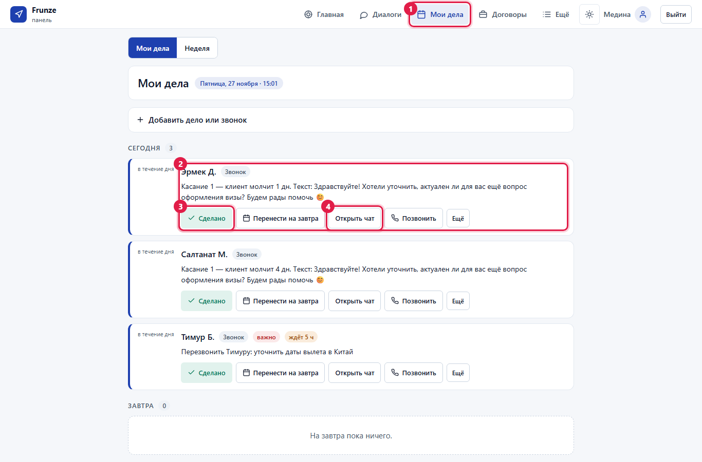

2. Дело-касание: имя клиента, «Касание 1 — клиент молчит 1 дн.» и **готовый
   текст**.
3. **«Сделано»** — нажмите после того, как написали клиенту.
4. **«Открыть чат»** — откроет переписку с этим клиентом.

Ещё есть **«Перенести на завтра»**, **«Позвонить»** и **«Ещё»**.

**Как выполнить касание:**

1. Нажмите «Открыть чат».
2. Скопируйте текст подсказки (или напишите своими словами) и отправьте клиенту.
3. Вернитесь в «Мои дела» и нажмите **«Сделано»**.
4. По желанию перетащите карточку клиента на доске в колонку «Касания».

Тексты касаний:

- **Касание 1 (через 1 день):** «Здравствуйте! Хотели уточнить, актуален ли для
  вас ещё вопрос оформления визы? Будем рады помочь 😊»
- **Касание 2 (через 3 дня):** «Добрый день! Ранее вы интересовались оформлением
  визы. Подскажите, планируете ли вы поездку? Мы можем помочь с подготовкой
  документов и записью на подачу.»
- **Касание 3 (через 6 дней):** «Здравствуйте! Хотели ещё раз уточнить, актуально
  ли для вас оформление визы. Если решите начать оформление, будем рады вам
  помочь!»

**Что должно получиться.** Дело исчезло из списка на сегодня.

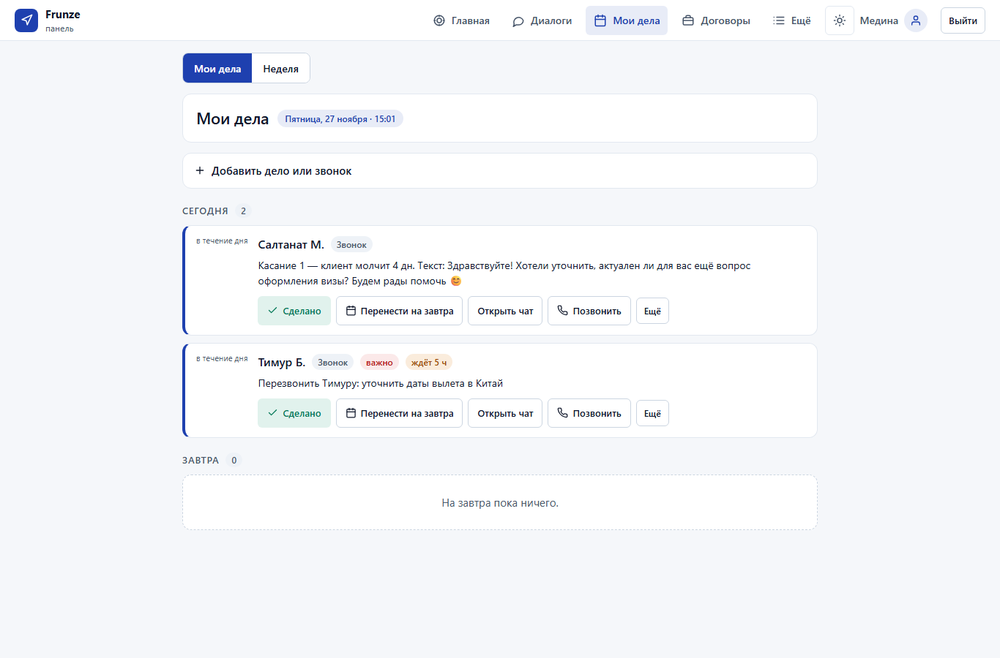

Касания приходят только по **вашим** клиентам (тем, с кем вы уже говорили), и
только по визам. В день приходит не больше 10 новых касаний.

Клиент ответил после третьего касания? Работайте дальше как обычно. Не ответил
— закройте его с причиной «Не отвечает» (раздел 8).

---

## 8. Закрыть клиента: «Клиент отказался» и причина

**Что нажать.** В открытой переписке кнопка **«⋮»** справа вверху (1). В меню
раздел **«Чем закончилось»** (2).

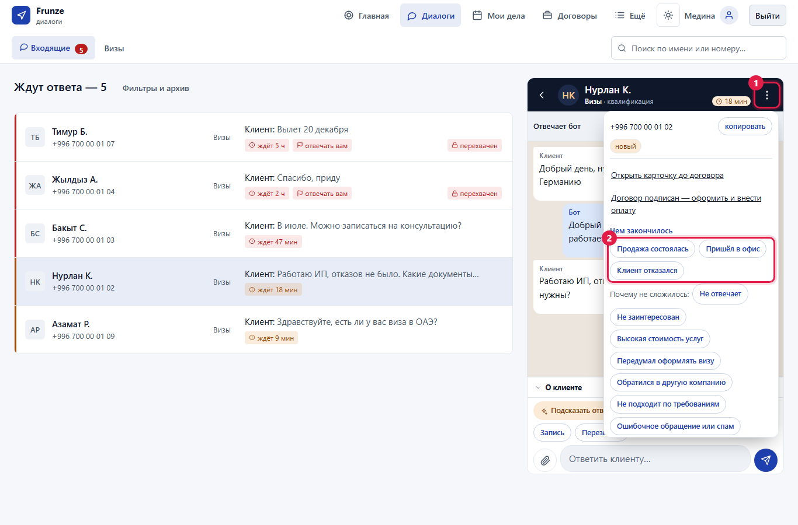

Три кнопки:

- **Продажа состоялась** — клиент заплатил;
- **Пришёл в офис** — клиент дошёл до офиса;
- **Клиент отказался** — не сложилось.

Нажмите **«Клиент отказался»** и сразу выберите причину под строкой «Почему не
сложилось»:

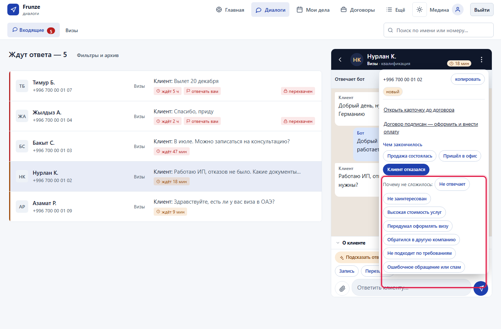

1. Не отвечает
2. Не заинтересован
3. Высокая стоимость услуг
4. Передумал оформлять визу
5. Обратился в другую компанию
6. Не подходит по требованиям
7. Ошибочное обращение или спам
8. Отложил поездку (последняя, если не видно, прокрутите меню вниз)

**Что должно получиться.** Кнопки «Клиент отказался» и выбранная причина стали
тёмно-синими.

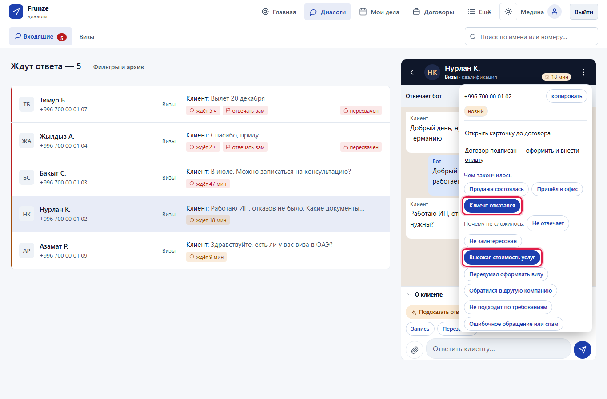

Ошиблись — нажмите другую причину или другой итог, прежний заменится.

---

## 9. Договор подписан

> **Пометка для Алана.** Этот раздел на стенде **не заработал до конца**, и
> показывать его менеджеру лучше после проверки на проде. Форма открывается,
> но пишет: «Для вашего направления договор в CRM пока не оформить:
> администратор ещё не настроил список продуктов». Это потому, что для визовых
> услуг не опубликован процесс (на стенде их и не публиковали). Опубликован
> ли он на проде, без доступа к серверу проверить нельзя. Если не опубликован,
> менеджер увидит ровно такой экран.

Где это в панели: в переписке **«⋮»** → две ссылки (на картинке 1 и 2):

- **«Открыть карточку до договора»** — завести карточку клиента до подписания;
- **«Договор подписан — оформить и внести оплату»** — после подписания.

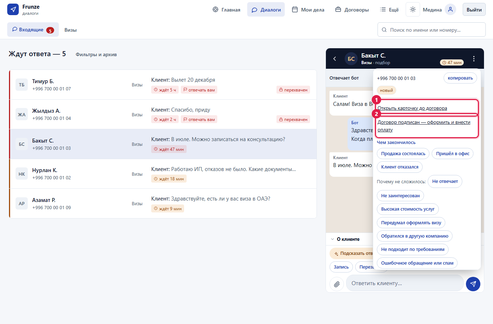

Форма «Договор подписан»: продукт, номер договора, когда подписан, сумма и
валюта, галочка «Подтверждаю…» и «Сохранить договор». Если клиент ещё не
закреплён за вами, сверху будет кнопка **«Взять клиента себе и продолжить»**.

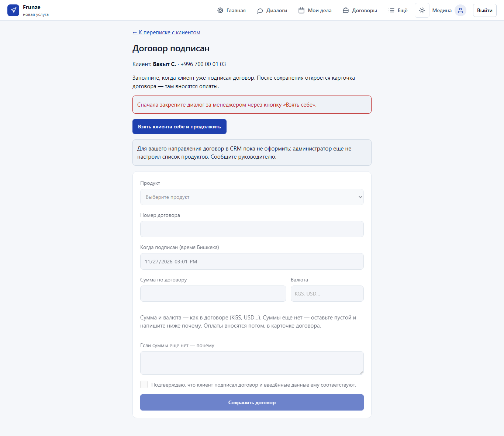

После сохранения клиент появится в разделе **«Договоры»** верхнего меню. Пока
договоров нет, там написано «Открытых услуг за вами нет».

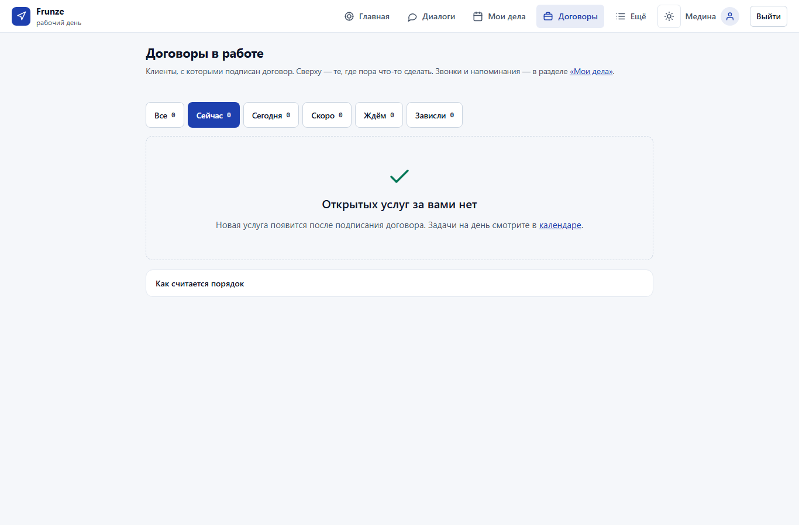

---

## 10. С телефона

Панель работает в браузере телефона по тому же адресу. Меню переезжает вниз:
**Главная · Диалоги · Мои дела · Договоры · Ещё**.

| Главная | Входящие | Переписка | Мои дела |
|---|---|---|---|
| 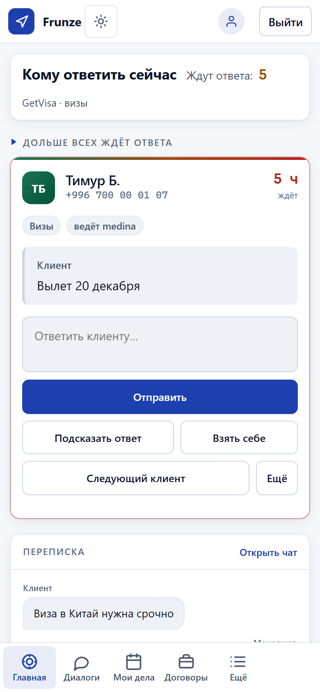 | 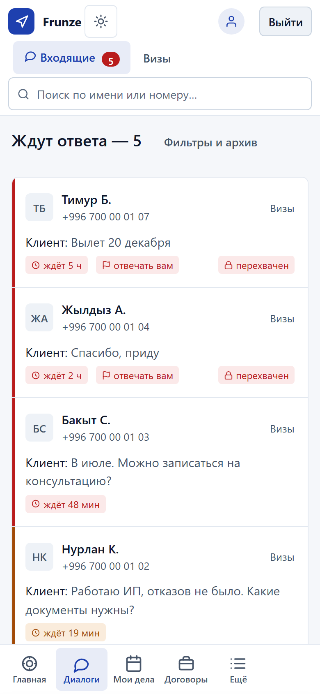 | 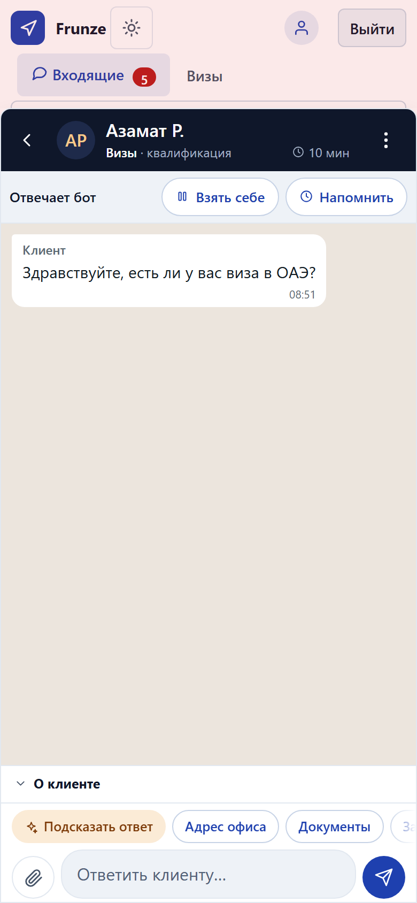 | 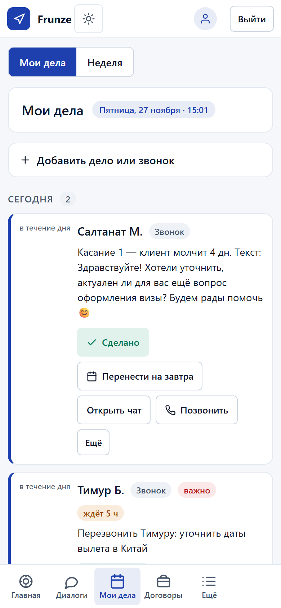 |

- Отвечать, отправлять файлы, отмечать «Сделано» и закрывать с причиной на
  телефоне можно так же, как на компьютере.
- Стрелка «‹» слева вверху в переписке возвращает к списку.
- **Доску с телефона лучше не использовать**: колонки не помещаются и
  наезжают друг на друга, а перетаскивать карточки пальцем неудобно. Переносите
  карточки с компьютера.

  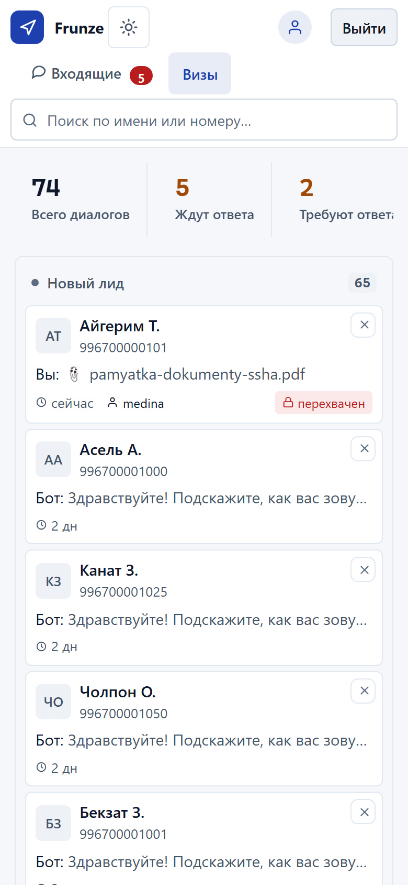

---

## 11. Частые проблемы

**«Не вижу клиента».**

1. Наберите в поиске часть номера (последние 4 цифры) или имя. Поиск ищет по
   всем вашим клиентам, в том числе по старым.

   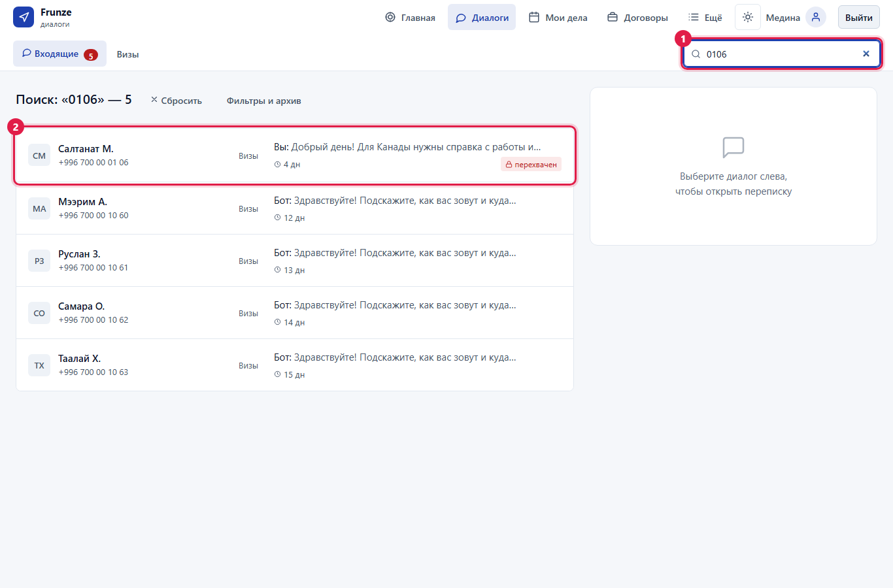

2. Не нашёлся — возможно, клиент написал на номер другого направления (визы и
   туры разделены: визовый менеджер видит только визовых клиентов).
   Напишите Алану номер клиента.
3. Клиента ведёт коллега — вы видите его с пометкой «ведёт …», но ответить не
   получится. Передать клиента может только администратор.

**«Бот ответил вместо меня».** Бот молчит только после того, как вы ответили
из панели или нажали «Взять себе». Открыли чат и успели только прочитать — бот
отвечает дальше. Хотите вести клиента сами, нажмите **«Взять себе»** сразу.
Если бот ответил после вашего ответа из панели, сделайте скриншот и отправьте
Алану.

**«Страница не обновляется».** Списки обновляются сами: «Входящие» примерно раз
в 10 секунд, переписка раз в 4 секунды, доска раз в 15 секунд. Пока вы печатаете
ответ, переписка не обновляется, чтобы не стереть ваш текст. Если ничего не
меняется дольше минуты, обновите страницу: F5 на компьютере, на телефоне
потяните страницу вниз.

**«Выкинуло из панели».** Войдите снова. Если вы пришли по ссылке на клиента,
после входа откроется этот клиент.

**Кому писать.** По всем вопросам Алану. Пришлите: ваш логин, номер клиента,
что нажимали и скриншот экрана.

---

## 12. Туры (Даулет): чем отличается

Вход тот же, логин `daulet`. Вы видите только туровых клиентов.

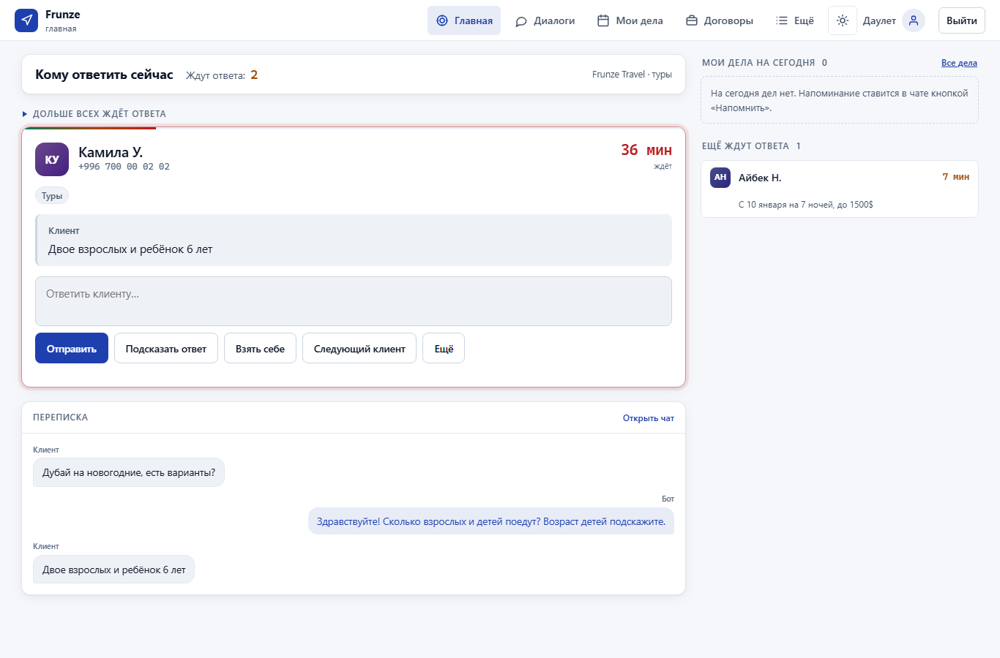

«Главная», «Входящие», переписка, «Напомнить», файлы и «Чем закончилось»
работают так же, как в визах (разделы 2–4 и 8).

Отличия:

- Вкладки в «Диалогах»: **«Туры»** и **«Билеты»** вместо «Визы».
- У туровой доски свои колонки: **Новый · Квалификация · Подбор / оценка · В
  офис / консультация · У менеджера · Молчат (на дожим) · Повторное касание**.
- **Касаний по турам нет**: напоминания через 1/3/6 дней приходят только по
  визам. Повторный контакт ставьте себе вручную кнопкой «Напомнить».
- Причины отказа те же восемь, что у виз (их составляли для виз). Вместо
  «Передумал оформлять визу» для тура выбирайте «Не заинтересован» или
  «Отложил поездку».

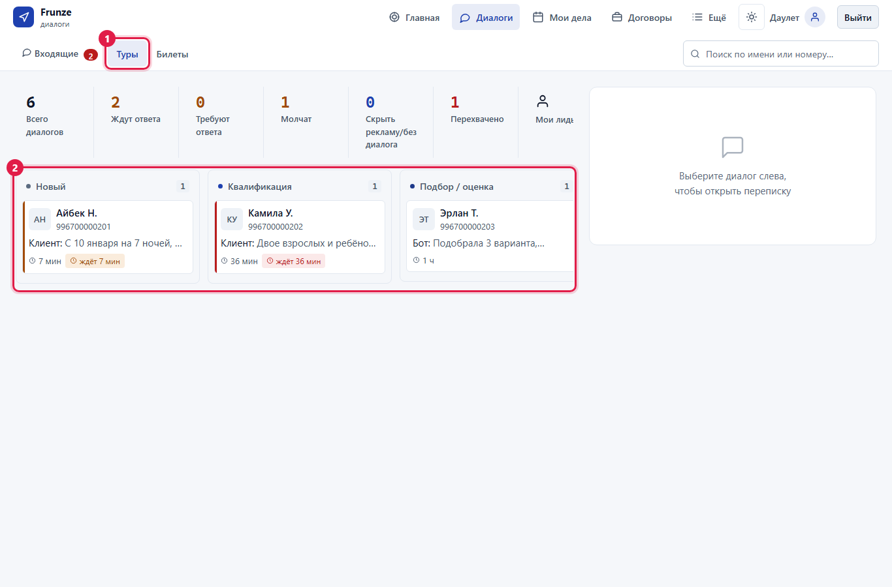

---

## Чек-лист онбординга (для Алана)

Онбординг пройден, когда человек **сам, своими руками** сделал всё ниже. На
боевой панели упражняйтесь на настоящем клиенте вместе с Аланом либо на
служебном номере.

- [ ] Вошёл под своим логином и вышел кнопкой «Выйти»; вошёл снова с телефона.
- [ ] На «Главной» объяснил своими словами, кто ждёт дольше всех и сколько
      клиентов ждут ответа.
- [ ] Нашёл клиента поиском по последним 4 цифрам номера.
- [ ] Ответил клиенту из переписки и увидел галочку под сообщением.
- [ ] Объяснил, что значит «Отвечаете вы — бот молчит», и нажал «Вернуть боту».
- [ ] Отправил клиенту файл (PDF или фото).
- [ ] Поставил себе напоминание кнопкой «Напомнить» и нашёл его в «Мои дела».
- [ ] Выполнил касание: открыл чат из «Мои дела», отправил текст, нажал «Сделано».
- [ ] Заполнил у визового клиента «Данные по визе» (страна, тип визы) и
      увидел их в строке над «О клиенте».
- [ ] Перетащил карточку на доске из «Новый лид» в «В работе».
- [ ] Включил и выключил «Требуют ответа» и «Мои лиды»; нажал «Ещё N ·
      показать все».
- [ ] Закрыл клиента: «Клиент отказался» и причина.
- [ ] Знает, кому писать, если что-то не так, и что приложить (логин, номер,
      скриншот).
- [ ] Только для туров (Даулет): открыл вкладку «Туры» и знает, что касаний по
      турам нет.

Шаг 9 (договор) в чек-лист пока не входит: см. пометку для Алана в этом разделе.

---

### Для Алана: как пересняты картинки

Стенд локальный, на выдуманных данных, наружу ничего не отправляет. Скрипты
лежат в `scripts\onboarding\`: `stand.py`, `shots.py`, `visa_shots.py`. Включены те же функции, что на проде на
27.11.2026. Учётки стенда: medina, daulet, marsel, grisha-admin, пароль `demo`.

```
.venv\Scripts\python.exe scripts\onboarding\stand.py       # сервер http://127.0.0.1:8111
.venv\Scripts\python.exe scripts\onboarding\shots.py       # все картинки в docs\onboarding\img
.venv\Scripts\python.exe scripts\onboarding\visa_shots.py  # «Данные по визе»: 05a–05c, 10f
```
